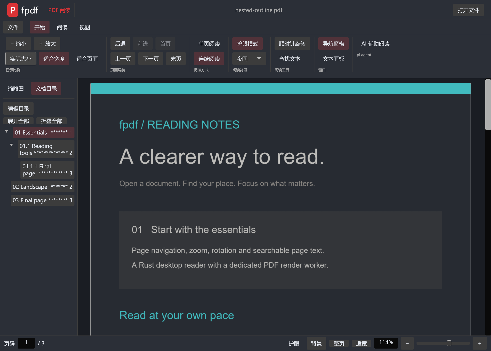
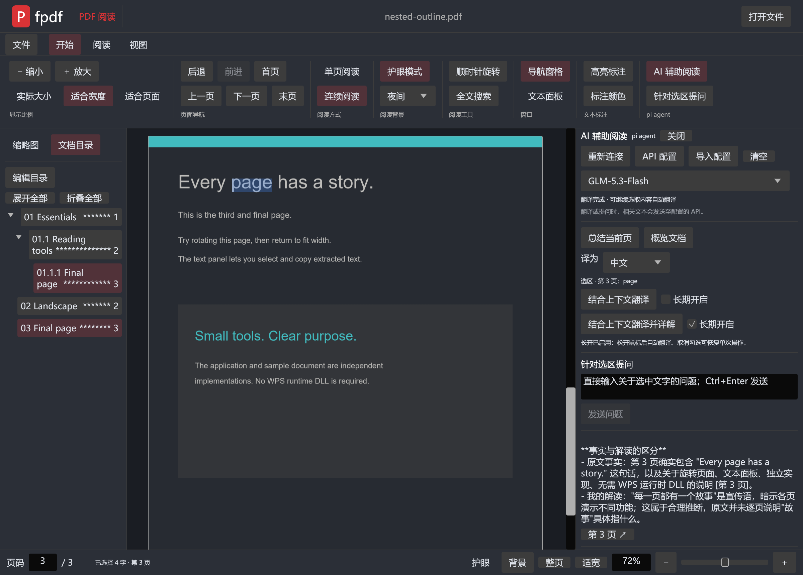

# fpdf

Windows x64 PDF 阅读器，使用 Rust 编写。支持连续阅读、目录编辑、夜间与护眼模式，以及基于 pi agent 的 AI 辅助阅读。PDF 解析使用独立 PDFium，无需安装 WPS。

[下载最新版](https://github.com/libo-libo/FPDF/releases/latest) · [中文 PDF 使用说明](https://github.com/libo-libo/FPDF/releases/download/v0.8.1/fpdf-0.8.1-user-guide-zh-CN.pdf) · [更新记录](CHANGELOG.md)



## 从 GitHub 下载和安装

1. 打开 [FPDF 仓库](https://github.com/libo-libo/FPDF)，点击右侧 **Releases**；也可以直接打开[版本下载页](https://github.com/libo-libo/FPDF/releases/latest)。
2. 进入最新版本（当前 **v0.8.1**），展开下方 **Assets**。点击文件名下载，无需 Git 或 GitHub 账号。
3. 选择下面的安装程序或免安装包。`Source code (zip)` / `Source code (tar.gz)` 是开发用源码，不能直接作为阅读器运行。

| 文件 | 使用方法 |
| --- | --- |
| `fpdf-0.8.1-windows-x64-setup.exe` | 双击，按向导安装到当前用户目录，创建开始菜单快捷方式；可在 Windows 设置中卸载。 |
| `fpdf-0.8.1-windows-x64.zip` | 右键 → 全部解压，再打开解压目录中的 `fpdf.exe`。 |
| `fpdf-0.8.1-user-guide-zh-CN.pdf` | 中文使用说明，包含下载、阅读、目录编辑和 AI 翻译。 |
| `SHA256SUMS.txt` | 下载校验值，使用以下命令核对。 |

要求 Windows 10/11 x64。发行包自带 PDFium 与 AI 所需的 Node.js，无需安装 Rust、Node.js 或开发工具。**保留整个程序目录**，包括 `pdfium.dll`、`ai/` 和许可证，不能只复制 `fpdf.exe`。当前安装程序未做代码签名。

在 PowerShell 中计算文件 SHA-256，与同版本的 `SHA256SUMS.txt` 对照：

```powershell
Get-FileHash .\fpdf-0.8.1-windows-x64-setup.exe -Algorithm SHA256
```

升级前关闭旧版，再运行新安装程序；免安装版建议解压到新目录。自行创建的 AI 配置建议放在 `%APPDATA%/fpdf/agent.txt`，便于升级保留。

0.8.1 修正版补充了 Windows P 图标、应用内 API 配置和一键卸载入口。安装版可从“文件 → 卸载 fpdf（清除全部配置）”或开始菜单同名入口一键移除程序及其保存的 AI 配置、主题、缓存和日志；保留用户 PDF。Windows 设置的“已安装的应用”也支持卸载。

## 基本阅读

- 点击“打开文件”、按 `Ctrl+O`，或把 PDF 拖入窗口。加密文档按提示输入密码。
- 默认连续阅读，可切换“单页阅读”。右侧实心滚动条支持拖动定位。
- 点击缩略图、目录名称或右侧页码跳转；底部可输入页码。“后退 / 前进”返回先前位置。
- 顶部及底部均有缩小 / 放大；百分比支持输入 **10%–500%** 后按 Enter，也可拖动滑块或使用 `Ctrl+滚轮`。
- “实际大小”为 100%；“适合宽度”随窗口调整，“适合页面”完整显示当前页；旋转每次 90°。
- 连续模式缩小后按可用宽度自动显示每行 **2、4、8 页**；放大恢复单列。点击小页面选为当前页。单页模式始终显示一页。
- `Ctrl+F` 或“全文搜索”在整个 PDF 中查找，右侧显示页码、上下文片段和进度；点击结果定位，支持上一个/下一个、区分大小写与全词匹配。页面中的命中为黄色，当前结果为橙色。“文本面板”仍可复制当前页文字。

## 文本高亮标注

双击单词或拖动选择同页多行文字，然后点击“高亮标注”、按 `Ctrl+F2`，或右键选区选择高亮颜色。支持黄色、绿色、蓝色和粉色；“标注颜色”菜单也可添加高亮并另存副本。

高亮保存为标准 PDF Highlight 标注，重新打开或使用其他兼容阅读器时仍可显示。查找产生的临时高亮不会写入 PDF。加密、含数字签名或被外部修改的 PDF 会停止保存并提示原因。

## 文档目录：折叠、改名和页码

左侧“文档目录”显示 PDF 自带书签。章节名称与目标页码之间用 `*` 引导，所有层级页码统一右对齐。点击名称或页码跳转；无跳转目标的分组不显示页码。

点击三角形折叠或展开，也可“展开全部 / 折叠全部”。**双击目录名称即可原位改名**：Enter 或点击其他位置保存到原 PDF，Esc 取消。页码和星号只是显示，不会写入书签名称。

“编辑目录”支持新增章节/子章节、目标页码、层级和顺序、删除及撤销。可保存到原 PDF 或另存副本，重新打开仍生效。重要文件建议先另存；源文件被其他程序修改时会停止保存。加密或含数字签名的 PDF 暂不支持目录编辑。

## 夜间、护眼与自定义 RGB

顶部背景菜单提供默认、夜间、护眼、羊皮纸四种主题。底部也有背景与护眼入口。“自定义 RGB…”直接显示调色盘：点击选色、拖动亮度条，或输入 R/G/B（各 0–255）。选色立即预览，“确定”保留，“取消”恢复原色。

主题只改变显示，不修改 PDF；重启后保留在 `%APPDATA%/fpdf/reading-theme.txt`。

## AI 辅助阅读

无需先打开 PDF，即可点击“连接”测试 API、获取模型列表，或使用“保存并连接”。PDF 总结、翻译及问答仍需先打开文档。0.8.1 已修复未打开文档时连接按钮灰色不可用的问题。

AI 使用 pi agent core / pi-ai，默认模型 **GLM-5.3-Flash**。**发布文件不包含作者的 AI 接口地址、密钥或账号**，需要自行配置兼容 OpenAI 的服务。

复制 `agent.example.txt` 为 `agent.txt`，填写两行（以下都是占位符）：

```text
https://your-api.example/v1
YOUR_API_KEY
```

新版推荐直接在 AI 面板点击 **API 配置**，填写接口地址与密钥，选择“保存并连接”。密钥输入默认隐藏，配置原子保存到 `%APPDATA%/fpdf/agent.txt`，重启后仍可用。“API 配置”在 AI 忙碌时仍可打开；导入已有文件使用单独的“导入配置”，不会阻塞阅读窗口。

也可用环境变量 `FPDF_AGENT_CONFIG` 指定配置文件，或把文件放在程序旁。当前用户的 AppData 配置优先于程序旁和工作目录中的同名文件，避免安装版被旧配置干扰。不要把真实配置提交到 GitHub。

点击“AI 辅助阅读”即可直接看到问题输入框，无需先翻译。选中文字后可点击工具栏或右键中的“针对选区提问”，问题会包含选区、附近上下文和页码；也可直接问整份文档。输入后点击“发送问题”（未连接时为“连接并提问”），或按 `Ctrl+Enter`。

可从服务返回的列表切换模型，可用性取决于自己的服务权限。“总结当前页”“概览文档”快速获取要点。回答流式显示，“第 N 页”可跳转引用。切换文档或模型会结束旧会话。

### 选词翻译：单次与长开

在 PDF 页面双击单词，或按住左键拖动选择同页多行文字，蓝色高亮实时更新。两个按钮保留单次操作，并分别提供“长期开启”复选框：

| 选项 | 行为 |
| --- | --- |
| 结合上下文翻译 | 根据附近文字翻译选区，保留专有名词、数字和公式。 |
| 结合上下文翻译并详解 | 先翻译，再解释术语、指代、难句结构与含义。 |
| 长期开启 | 勾选后，每次选词或拖选松手即自动翻译。两种长开模式互斥。 |

无需额外提问或发送。处理时显示“翻译进行中…”，译文实时更新。新选区取消旧任务；“停止本次”只停止当前翻译，不关闭长开。单次按钮不改变长开状态。长开在本次运行中保持，重启后需重新开启。



普通阅读在本机完成。连接时读取模型列表；AI 问答或翻译会把问题、文件名、目录、选区及相关页面文本发送给自己配置的服务。Agent 只提供 PDF 文本读取工具，每次最多读 5 页，没有命令执行或文件写入工具。扫描图片文字目前需要另行 OCR。

## 快捷键和常见问题

| 快捷键 | 功能 |
| --- | --- |
| `Ctrl+O` / `Ctrl+F` | 打开 / 全 PDF 查找 |
| `Ctrl+F2` | 将选中文字保存为高亮标注 |
| `PageUp` / `PageDown` | 上一页 / 下一页 |
| `Ctrl+Home` / `Ctrl+End` | 首页 / 末页 |
| `Alt+Left` / `Alt+Right` | 后退 / 前进 |
| `Ctrl+0` / `Ctrl+1` | 适合宽度 / 实际大小 |
| `Ctrl++` / `Ctrl+-` / `Ctrl+滚轮` | 缩放 |
| `Ctrl+Enter` | 在文档问答输入框发送 |

- 缺少 `pdfium.dll`：完整安装或解压，保留整个目录。
- AI 无法连接：保留 `ai/`，检查配置格式、服务地址、密钥与模型权限。
- 无法选择文字：扫描页通常没有文字层；当前仅支持同页选区。
- 目录保存失败：检查写权限、外部修改、密码与数字签名，或另存副本。

暂不提供 OCR、跨页拖选、附注文本编辑、页面内容编辑或打印。单文件最多 512 MiB。全文查找最多显示每页 2,000 条、全篇 20,000 条，达到上限会提示。

## 从源码构建

安装 Rust stable（支持 edition 2024）、Windows C++ Build Tools / SDK（默认 MSVC 工具链）及 Node.js 24。在 PowerShell 中执行：

```powershell
git clone https://github.com/libo-libo/FPDF.git
cd FPDF
npm.cmd ci --prefix ai-runtime
node scripts/build-ai.mjs
./scripts/fetch-pdfium.ps1
./scripts/build.ps1
```

输出为 `dist/fpdf/`。PDFium 地址与 SHA-256 固定在脚本中，依赖由 `Cargo.lock` / `package-lock.json` 锁定。首次构建需要联网下载依赖与许可证。`scripts/dev-env.ps1` 仅供本地 GNU 开发环境使用，常规 MSVC 构建无需加载。

```powershell
cargo fmt --check
cargo clippy --locked --all-targets -- -D warnings
cargo test --locked
npm.cmd test --prefix ai-runtime
cargo run -- tests/fixtures/reading-demo.pdf
cargo run -- --smoke-ui tests/fixtures/nested-outline.pdf --screenshot window.png --features --screenshot-night
cargo run -- --smoke-ui tests/fixtures/nested-outline.pdf --screenshot search.png --search-features --screenshot-night
```

生成手册：`pip install -r scripts/requirements-docs.txt`，再运行 `python scripts/create-user-guide.py`；默认 Windows 黑体，也可用 `FPDF_GUIDE_FONT` 指定中文 TTF。输出在 `output/pdf/`。安装 Inno Setup 6 后，执行 `./scripts/package-release.ps1 -IsccPath 'C:/Program Files (x86)/Inno Setup 6/ISCC.exe'` 制作安装包。

## 源码结构与许可证

`src/app.rs` 为界面，`src/reading.rs` 为布局与主题，`src/pdf.rs` 封装 PDFium，`src/worker.rs` 在专用线程执行原生 PDF 操作，`src/ai_reader.rs` 与 `ai-runtime/bridge.mjs` 实现 AI 通信。测试和自建样例在 `tests/`，构建脚本在 `scripts/`，安装脚本在 `installer/`。

应用代码采用 [MIT](LICENSE) 许可证。PDFium、Node.js、pi 及 Rust 依赖许可证随包提供。界面与素材独立实现，发行包不包含 WPS 程序或其私有 DLL。反馈请使用 [GitHub Issues](https://github.com/libo-libo/FPDF/issues)，贡献约定见 [AGENTS.md](AGENTS.md)。
